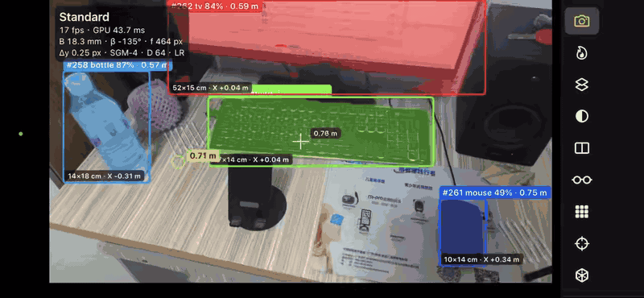

<p align="center"></p>

<p align="center"><a href="docs/demo.mp4"></a><br><sub>在 iPhone 15 Plus 上录制 · 点击查看 0.8 MB 的 MP4 原片</sub></p>

# StereoVision

> ### 📱 已适配 iPhone 15 Plus 这类「两颗后置摄像头呈对角排列」的机型
>
> 原实现是按 iPhone 16 写的：两摄竖排，横屏后基线正好水平，配准不需要滚转。iPhone 15 Plus 的两颗镜头在对角线上，横屏后基线相对画面约 ±45°，而立体匹配只能沿图像行搜索，所以配准必须把两幅图一起滚转——若直接显示，画面就是歪的、四角大片黑边。
>
> 现在的做法：匹配仍在滚转后的坐标系里进行，再用单应 $M = K R_{\text{rect}} K^{-1}$ 把深度图反向旋转回**广角镜头自身的坐标系**。于是画面保持正立，物体掩码、检测框、点云与导出数据也都统一在这个坐标系里；*Rectified pair* 视图保留滚转后的配准对，用于检查极线对齐。代价是这类机型的深度图会丢掉画面四角（落在滚转矩形之外）。
>
> HUD 里的基线角度 $\beta$ 可以直接确认镜头排布：接近 0°/180° 为左右并排，接近 ±45°/±135° 为对角排列（本页演示视频中为 −135°）。细节见 [镜头排布](#镜头排布)。

StereoVision 把 iPhone 的后置双摄（广角 + 超广角）变成一台实时的**立体相机**：测出物体的远近，用自己训练的语义分割模型识别并勾出物体轮廓（当前模型的分割目标是 `Lens`），并用 9 种方式呈现场景，从经典深度图到可以拖动旋转的 3D 点云。

> **已在 iPhone 16 与 iPhone 15 Plus 上测试。** 只要 iPhone 有「广角 + 超广角」后置双摄就能跑，与两颗镜头的排布无关：程序会读取这对镜头的外参，因此竖排（iPhone 16）、对角（iPhone 13–15）或水平排布都能被正确配准。相机格式、标定与帧率可能因机型而异。LiDAR 数据源尚未在真机上运行过。

这是一个个人学习项目，与任何课程作业或考试无关。写它是为了把「人工视觉」课上的概念真正跑起来：对极几何、配准、立体匹配、三角测量与目标检测——看着它们在手机上实时运行，比看公式好懂得多。

完整的立体流程（配准、匹配、三角测量）都是从零写的，全部跑在 GPU 上。你随时可以切换到 Apple 自己的深度，或 Pro 机型上的 LiDAR 扫描仪，用来做对比。

## 功能

- **实时深度**：在 iPhone 16 上约 20+ fps
- **目标检测与分割**：用自己训练的语义分割模型（`lens-seg`：YOLO11n 骨干 + 轻量语义头，256×256，2 类 `background` / `Lens`），把分割结果变成带类别、置信度、彩色掩码的物体，并跨帧跟随（同一类的碎片会合并成一个物体）
- **尺寸测量**：每个物体给出距离、横向偏移和近似宽 × 高（cm）
- **点选测距**：点屏幕上任意一点即可测距；准星始终显示画面中心的距离
- **三种深度来源**：自研立体匹配（默认）、Apple 的 Dual-Wide 深度、以及 iPhone Pro（12 Pro 及以后）上的 LiDAR。没有该传感器的机型不会出现 LiDAR 选项。LiDAR 用激光飞行时间直接测距，在立体视觉失效的无纹理墙面上也能工作，量程约 5 m，因此很适合作为评估立体匹配的真值
- **拍照与录像**：录下的正是屏幕上看到的内容（当前视图模式，含掩码、标签与距离），保存到「照片」。视频为 HEVC、1280 px、30 fps
- **原始数据导出**：每次拍照都会在 *文件 › 我的 iPhone › StereoVision* 里导出一份，便于离线分析（Python、OpenCV、MeshLab……）：

  | 文件 | 内容 |
  |---|---|
  | `view.png` | 合成后的画面，与存入「照片」的内容一致 |
  | `rgb.png` | 深度所对应的彩色图 |
  | `depth_mm.png` | 16 位灰度深度，单位毫米（0 = 无效） |
  | `cloud.ply` | 彩色点云，单位米（x 向右、y 向下、z 向前） |
  | `meta.json` | 内参、基线、深度来源与各项设置、检测到的物体及其距离和尺寸 |
- **自动标定**：启动时自动标定两摄的相对姿态，也可以在设置里手动微调

## 视图模式

| 模式 | 看到什么 |
|---|---|
| **Standard** | 相机画面 + 物体掩码、检测框、标签、距离与尺寸 |
| **Depth map** | 用颜色表示距离：红=近，蓝=远 |
| **Overlay** | 相机画面与深度图叠加（透明度可调） |
| **Disparity** | 原始视差的灰度图（越亮越近） |
| **Rectified pair** | 两幅配准后的图并排显示，绿线为对齐参考线：同一个点在两幅图中必须落在同一条线上 |
| **Anaglyph** | 红/青立体图，配红青眼镜观看 |
| **3D segmentation** | 只靠深度把场景切成面片与物体，不需要知道它们是什么 |
| **Bird's-eye** | 俯视图：视场、距离圈、障碍物剖面，以及按位置摆在平面图上的物体 |
| **Point cloud** | 3D 重建的点云：拖动旋转、双指缩放、点击复位 |

## 距离是怎么算出来的

两台相机从略微不同的位置看同一个场景，近处物体在两张图之间的位移比远处更大。这个位移就是**视差** $d$（像素）。把两张图对齐（**配准**）之后，距离由三角测量给出：

$$Z = \frac{f \cdot B}{d}$$

- $Z$：到相机的距离（m）
- $f$：焦距（px），在 640 × 360 的工作分辨率下约 470 px
- $B$：基线，两颗镜头的间距：iPhone 16 约 1 cm，iPhone 15 Plus 的对角双摄约 1.4 cm
- $d$：视差（px）

逐像素求 $d$ 用的是**半全局匹配（SGM）**：每个像素与另一幅图中的候选位置比较代价，然后算法倾向于平滑表面、惩罚跳变，用两个惩罚项 $P_1$（1 像素的小台阶）和 $P_2$（真正的深度边缘）。接着**左右一致性检查**丢掉两视图不一致的像素，通常是遮挡区域或错误匹配。物体的横向位置与尺寸再由针孔模型得到：

$$X = \frac{(u - c_x)\,Z}{f} \qquad W_{\text{object}} = \frac{w_{\text{px}}\,Z}{f}$$

### 镜头排布

配准要把两幅图一起旋转，使极线落在图像的行方向上——因为匹配器只沿 $x$ 搜索。旋转多少由两颗镜头的位置决定：

| 机型 | 镜头位置（横屏时） | 配准滚转角 |
|---|---|---|
| iPhone 16 | 左右并排，基线水平 | ≈ 0° |
| iPhone 15 Plus 及 13–15 系列 | 呈对角，基线约 ±45° | ≈ 45° |

对角排布时，配准结果整体被滚转，直接显示就会得到一幅歪掉、四角发黑的画面。为此程序把匹配留在滚转后的坐标系里，再用单应 $M = K R_{\text{rect}} K^{-1}$（滚转的逆变换）把深度图转回广角镜头自身的坐标系。这样屏幕上看到的是原始、正立的相机画面，物体掩码、检测框、点云与导出数据都基于这个坐标系；而 *Rectified pair* 视图仍然显示滚转后的配准对——它才是「匹配点必须共享同一条绿线」的那个视图。这类机型的深度图会丢掉画面四角，因为四角落在滚转矩形之外。HUD 里的基线角度 $\beta$：接近 0° 或 180° 是左右并排，接近 ±45° 或 ±135° 是对角排列。

## 局限

最主要的限制来自物理：**基线太窄**（≈ 1 cm，而人眼间距 ≈ 6.5 cm）。下面的数字按 $f \cdot B \approx 4.7\ \text{px}\cdot\text{m}$ 计算；App 的 HUD 会显示你真机上的 $B$ 与 $f$。

**深度误差随距离的平方增长。** 对 $Z = fB/d$ 求导：

$$\Delta Z \approx \frac{Z^2}{f \cdot B}\,\Delta d$$

取亚像素精度 $\Delta d \approx 0.2$ px：

| 距离 | 预期深度误差 |
|---|---|
| 0.5 m | ± 1 cm |
| 1 m | ± 4 cm |
| 2 m | ± 17 cm |
| 3 m | ± 38 cm |

**最大有效量程。** 当 $d = 1$ px 时 $Z = fB \approx 4.7$ m；超过 2–3 m 后基本就是噪声了。这是物理限制，不是 bug。

**最近距离。** 由搜索的最大视差决定，$Z_{min} = fB / d_{max}$：

| 最大视差 | 最近可测距离 |
|---|---|
| 32 px | ≈ 15 cm |
| 64 px（默认） | ≈ 7 cm |
| 96 px | ≈ 5 cm |

实际上设置里的 *Min* 深度范围（默认 12 cm）也会截掉更近的部分，而且镜头本来也合不了那么近的焦。

**横向分辨率。** 一个像素覆盖 $Z/f$ 米：1 m 处约 2 mm，2 m 处约 4 mm。物体尺寸会继承深度误差：$Z$ 差 10%，宽高也差 10%。

**会骗过立体视觉的场景：**

- **无纹理表面**（白墙、光板桌面）：没有可匹配的特征。SGM 会从边缘往里填一部分，其余保持黑色（无效）
- **反光或透明物体**（镜子、玻璃、屏幕）：匹配到的是反射像，而不是表面本身
- **重复图案**（网格、瓷砖、百叶窗）：多个候选看起来一样好
- **遮挡边缘**：前景物体旁的一条窄带只有一台相机看得到，左右一致性检查会把它判为无效
- **细结构**（线缆、椅子腿）可能被平滑掉
- **暗光与快速运动**：传感器噪声与运动模糊会减少有效像素
- **画质差异**：超广角要被上采样约 2× 才能对齐广角，本身就模糊，限制了细节
- **标定漂移**：如果深度看起来不对，打开 *Rectified pair* 看特征是否落在同一条绿线上，然后按 *Calibrate*

检测是异步执行的，所以掩码可能略微滞后于快速运动的物体。

## 性能与精度

**速度（iPhone 16，SGM + 左右一致性检查 + 分割模型）：** 约 20–22 fps，稳定。相机上限 30 fps。想用精度换速度，可以把最大视差降到 32，或在设置里切换成块匹配。

**匹配精度**（`swift scripts/verify_stereo.swift`，在 Mac 上直接跑 App 的 GPU 代码；合成场景的视差已知，含一个斜面、一个前景物体，以及一条几乎没有纹理的区域（对比度 4%））：

| 算法 | 正确（±1 px） | 错误 | 无效 |
|---|---|---|---|
| 块匹配 5×5 | 62.2% | 6.5% | 31.2% |
| SGM，4 路径 | 75.2% | 13.9% | 10.8% |
| SGM + 左右一致性 | 72.4% | 9.3% | 18.3% |

- 相比块匹配，SGM 找回了大片低纹理区域：无效像素从 31% 降到 11%
- 左右一致性检查把错误匹配砍掉约三分之一，代价是多判掉一些无效像素
- 测试纹理是随机的，每次数字会略有不同

**检测物体的距离**取其掩码内部区域深度的中位数，因此检测框内的背景像素不会把它带偏；数值还会按物体随时间平滑。

## 快速开始

环境要求：具备 Dual-Wide 摄像头的 iPhone、iOS 18+、Xcode 26+（含 Metal Toolchain：`xcodebuild -downloadComponent MetalToolchain`），以及用来导出分割模型的 Python（torch + coremltools + segzoo 仓库的依赖，推荐直接用 segzoo 训练时那套 conda 环境）。

```sh
git clone <repo> && cd stereo-camera-iphone
cp Config/Local.xcconfig.example Config/Local.xcconfig   # 填入你的 Apple team ID 和唯一的 bundle id
python scripts/export_lens_seg.py \
    --ckpt <segzoo>/runs/lens_dataset/yolo11_n_256x256/best.pth --segzoo <segzoo>   # best.pth -> CoreML
open StereoVision.xcodeproj                              # 在你的 iPhone 上运行
```

`scripts/export_lens_seg.py` 读的是 segzoo 的 `best.pth`：里面只有 `state_dict` 和描述结构的 `meta`（arch / encoder / num_classes / img_size / 归一化），所以要靠 segzoo 的 `models.load_checkpoint()` 重建网络，再用 coremltools 导出。导出的模型把“/255 + 归一化 + softmax”都写进了图里，类名、输入尺寸、归一化参数写进 CoreML metadata，App 侧不硬编码任何类别（换数据集重训后只要重新导一次模型，同一个 App 就能跑）。

在 macOS / Linux 上脚本导出 float16 的 `.mlpackage`；Windows 上的 coremltools 缺原生库，会自动回退成 float32 的 `.mlmodel`——两者都会被 `project.yml` 的 preBuild 编译成 `lens-seg.mlmodelc`，App 侧无差别。

没有模型也能用，此时会退回到 Apple 自带的检测器（人、动物、显著物体）。把手机**横过来**：iPhone 16 请让灵动岛朝左；对于两颗镜头呈对角排列的机型（如 iPhone 15 Plus），两个横屏方向都可以，画面都会保持正立。

## 实现细节

给想读代码 / 想改算法的人。四段，各对应一个最常被问的问题。

### 标定：不用棋盘格

内参来自系统：`CMSampleBuffer` 的 `kCMSampleBufferAttachmentKey_CameraIntrinsicMatrix` 附件，取不到就退回针孔估计 $f = W/(2\tan(\text{FOV}/2))$、主点在画面中心。外参来自 `AVCaptureDevice.extrinsicMatrix(from:to:)`，得到 $R$（3×3）与 $t$（毫米）。**没有畸变模型**；工作分辨率固定 640×360，内参按 $640/W$ 缩放。

平移 $t$ 全程只用两处：**方向**定滚转角，**长度**定 $fB = f_x\lvert t\rvert/1000$（所以 $Z$ 的单位是米）。

### 极线矫正：只需求一个滚转角

基线躺在像平面内，所以不需要 Bouguet 的双单应。取矫正坐标系

$$e_1=\operatorname{sign}(t_x)\frac{t}{\lVert t\rVert},\quad
e_2=\operatorname{normalize}(-e_{1y},\,e_{1x},\,0),\quad
e_3=e_1\times e_2$$

此时 $e_3=(0,0,1)$，$R_{\text{rect}}$ 就是绕光轴的纯滚转，角度即 HUD 里的 $\beta=\operatorname{atan2}(t_y,t_x)$。两个重采样单应（**目标→源**，因为 kernel 是遍历目标像素反向回采样）：

$$H_W^{-1}=K\,R_{\text{rect}}^\top K_r^{-1},\qquad
H_U^{-1}=K_U\,R^\top R_{\text{rect}}^\top K_r^{-1}\,T_{\Delta y}$$

$T_{\Delta y}$ 是给超广角那一路的垂直平移，用来吃掉残余的极线不齐。深度图最后再用 $M=K_rR_{\text{rect}}K_r^{-1}$ 转回广角坐标系（对角机型因此会丢四角）。

所以 **Calibrate 不是重新标定**：只枚举 `flip`（用 $R$ 还是 $R^\top$，也就是谁当左目）× $\Delta y\in[-12,12]$ px，以整帧 Census 代价最小为判据；$R$、$t$ 始终信出厂值。整套推导的前提是 $t_z\approx 0$——否则 $e_3\ne(0,0,1)$，这里只是一个一致但近似的滚转。

### 视差匹配：传统方法，没有神经网络

Census 7×7 压成 48 bit，汉明距离当代价 → SGM 4 路径聚合（$P_2$ 随图像梯度自适应）→ WTA + uniqueness + 左右一致性 + 抛物线亚像素 → $Z=fB/d$。设置里可切成 5×5 块匹配。分割模型只做分割，**完全不参与视差**。

**为什么能实时**（约 20–22 fps）：640×360 只有 23 万像素；代价是 `popcount` 位运算；代价体积用 `uchar`（14.7 MB 而非 88 MB）；只跑 4 条路径；GPU 上「一个线程组 = 一条扫描线、线程 = 一个视差」，动态规划状态放在片上 `prev[]`、沿扫描线串行推进；整帧一条 command buffer，CPU 不读回。瓶颈是显存带宽（每帧约 300 MB，下限 ≈6 ms），不是算力。

代价同样明确：4 路径 + 8 bit 量化让错误率高于 8 路径 float 版本，所以左右一致性检查是必需品（见上面的精度表）。

深度模型不划算的原因：640×360 上的 4D 代价体积（64 视差 × 32 通道，fp16）就要 943 MB，必须降到 1/4 分辨率；RAFT/IGEV 一类在这个尺寸是几十到上百 GFLOP，手机会掉到 10 fps 以下。而它们的收益集中在无纹理/反光区——那里 1 cm 基线的物理天花板（2 m 处 ±17 cm）早已把精度封顶。

### Metal 是 API，不是芯片

芯片是 SoC 里的 GPU（iPhone 15 Plus 是 A16 的 5 核 GPU，6 GB 统一内存，带宽约 51 GB/s）；**Metal 是苹果的 GPU 编程接口**，MSL 是它的着色器语言，地位等同于 NVIDIA 的 CUDA。iPhone 没有独立显存，GPU 和 CPU 共用同一块内存，所以预算只有每进程的 jetsam 上限（6 GB 机型前台约 2.5–3 GB）——本项目的立体管线在 GPU 侧只占约 90 MB。

最值得借鉴的一段是 `Shaders.metal` 的 `sgmPath`：把方向依赖的动态规划压进线程组，`prev[]`、`simd_min` 归约、三个 barrier 就是全部秘诀。数据布局 `[(y*W+x)*D+d]`（AoS）不要改，否则 coalescing 全毁。

### 不装 Xcode 也能调

`tools/` 里有两个离线工具，配合 App 导出的数据把整条链路拆开看，详见 `tools/README.md`：

- `sgm_ref.py` —— 六个 kernel 的 numpy 逐行孪生实现，`--selftest` 逐元素对拍，精度与上表一致，可导出 4 条路径各自的中间结果
- `viewer.html` —— 以 **iPhone 上的 App 界面**（外框 / 侧边栏 / HUD / 设置页）回放导出目录，并能把真实画面 `view.png` 半透明叠上来做逐像素对照
